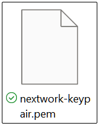

# Introduction

Hello everyone! This is Part 1 of a series of articles documenting how I built a CI/CD pipeline on AWS, which will be divied into different parts. This project is part of an assignment in my university course - Professional Practice in Computing.

1. _YOU ARE HERE!_ Setup of Web App in the Cloud
2. [Connecting GitHub Repository with AWS](#/article/aws-cicd-pipeline-part2)
3. [Secure Packages with CodeArtifact](#/article/aws-cicd-pipeline-part3)
4. [Continuous Integration with CodeBuild](#/article/aws-cicd-pipeline-part4)
5. [Initial Deployment with CodeDeploy](#/article/aws-cicd-pipeline-part5)
6. [Continuous Deployment with CodePipeline](#/article/aws-cicd-pipeline-part6)

## What is this project about?

Before code can be version-controlled, built, tested, or deployed automatically, there needs to be an application and a place to develop it. In this first part, I set up a cloud-based development environment on an Amazon EC2 instance, connected to it from VS Code, and generated a simple Java web application using Apache Maven.

Developing directly on a cloud server rather than a local machine is a common strategy in DevOps because it provides:

- **Consistency**: Every developer works against the same operating system, tools, and configuration
- **Accessibility**: The environment can be reached from any machine with the right credentials
- **Production parity**: The development environment closely resembles the servers the application will eventually run on
- **Scalability**: Compute resources can be resized on demand without upgrading local hardware

## How I built the web app in this project

In this project, I launched an EC2 instance, secured access to it with a key pair, connected to it over SSH from VS Code's terminal, installed Java and Maven, and generated a Java web application. I then used VS Code's Remote - SSH extension to browse and edit the application's files directly on the server.

This project took me approximately 1-2 hours to complete, including time spent understanding key pair permissions and SSH configuration. The most valuable lesson was seeing how a private key, file permissions, and an SSH client work together to provide secure access to a remote server.

---

## Launching an EC2 Instance

### Why EC2?

Amazon EC2 (Elastic Compute Cloud) provides virtual servers in the cloud. Since the goal is for the web app to be created and run entirely in the cloud, I used an EC2 instance to host all of my development work.

When launching the instance, I:

1. Selected an Amazon Linux AMI and a free-tier eligible instance type
2. Created a new key pair for secure access
3. Configured the network settings to allow SSH traffic


### Enabling SSH

SSH (Secure Shell) is a protocol for securely connecting to and controlling a remote server over an encrypted channel. Enabling SSH in the instance's security group opens port 22 so that I can connect to the instance from my computer.

**How SSH authentication works:**
Rather than a password, SSH on EC2 uses public-key cryptography. The public key is stored on the server, and when I connect, the server verifies that I hold the matching private key. Only someone in possession of that private key can log in.

**Best practice:** Restrict the SSH rule's source to your own IP address rather than `0.0.0.0/0` (anywhere), reducing exposure to automated scanning and brute-force attempts.

### Key Pairs

A key pair is like the key to your virtual computer. Just as you need a key to unlock and start a car, a key pair lets you securely access your EC2 instance. It consists of:

- **Public key** - Stored by AWS and placed on the EC2 instance
- **Private key** - Downloaded to your computer as a `.pem` file



Once I created the key pair, AWS automatically downloaded the private key to my computer. AWS does not keep a copy, so if this file is lost, it cannot be recovered—it must be stored safely and never shared or committed to a repository.

---

## Setting Up VS Code

### What is VS Code?

Visual Studio Code (VS Code) is one of the most popular tools for creating and managing coding projects. It is often referred to as an IDE (Integrated Development Environment)—software that combines a code editor, terminal, file explorer, and extensions in a single application.

I installed VS Code because its built-in terminal and extension ecosystem make it straightforward to connect to remote servers such as EC2 instances and edit files on them directly.

The first command I ran on the terminal was to navigate into the DevOps folder I have created.

```bash
cd ~/Desktop/DevOps
```

### Updating File Permissions

SSH clients refuse to use a private key if other users on the machine can read it, because a widely readable key defeats the purpose of having one. On Windows, I locked down the key's permissions using `icacls`:

```bash
icacls nextwork-keypair.pem /reset
icacls nextwork-keypair.pem /grant:r "%USERNAME%:R"
icacls nextwork-keypair.pem /inheritance:r
```

**Command breakdown:**

- `/reset` - Removes any custom permission settings and restores the defaults
- `/grant:r "%USERNAME%:R"` - Grants read-only access to my user account, replacing any existing grants
- `/inheritance:r` - Removes permissions inherited from the parent folder, so no other users retain access

**On macOS or Linux,** the equivalent is a single command: `chmod 400 nextwork-keypair.pem`.


---

## Connecting to the EC2 Instance

### The SSH Command

To connect to my EC2 instance, I ran:

```bash
ssh -i ./nextwork-keypair.pem ec2-user@<ec2-public-dns-address>
```

**Command breakdown:**

- `ssh` - Starts a secure shell session with a remote server
- `-i ./nextwork-keypair.pem` - Specifies the private key (identity file) used to authenticate
- `ec2-user` - The default username on Amazon Linux instances
- `<ec2-public-dns-address>` - The public address of the instance

### Public IPv4 DNS

A server's Public IPv4 DNS (Domain Name System) name is the public address the internet uses to find and connect to the EC2 instance. It resolves to the instance's public IPv4 address, and can be found on the instance's details page in the EC2 console.

**Note:** Unless an Elastic IP is attached, the public DNS name changes whenever the instance is stopped and started, so the SSH command needs to be updated accordingly.


---

## Installing Maven and Java

### Why Maven?

Apache Maven is a build automation and dependency management tool for Java projects. Building software involves compiling source code, downloading the libraries it depends on, running tests, and packaging everything into a deployable file. Maven automates all of these steps based on a single configuration file, `pom.xml`.

Maven is required in this project because it generates the web app's project structure and will later be used to build and package the application in the CI/CD pipeline.

### Why Java?

Java is a widely used programming language for building everything from mobile apps to large enterprise systems. I installed Amazon Corretto 8, a free, production-ready distribution of OpenJDK maintained by Amazon:

```bash
sudo dnf install -y java-1.8.0-amazon-corretto-devel
```

Java is required because the web app is written in Java, and Maven itself runs on the Java Virtual Machine (JVM).

### Verifying the Installations

After installing both tools, I need to confirm they are both available:

```bash
mvn -v
java -version
```

Each command prints the installed version, confirming the tool is installed correctly and available on the system `PATH`.

---

## Creating the Application

### Generating the Java Web App

I generated a Java web app using Maven's archetype plugin:

```bash
mvn archetype:generate \
   -DgroupId=com.nextwork.app \
   -DartifactId=nextwork-web-project \
   -DarchetypeArtifactId=maven-archetype-webapp \
   -DinteractiveMode=false
```

**Command breakdown:**

- `archetype:generate` - Creates a new project from a template (an "archetype")
- `-DgroupId=com.nextwork.app` - A unique identifier for the organisation or group that owns the project
- `-DartifactId=nextwork-web-project` - The name of the project and its root folder
- `-DarchetypeArtifactId=maven-archetype-webapp` - The template to use, in this case a basic Java web application
- `-DinteractiveMode=false` - Uses the values provided instead of prompting for each one


---

## Using Remote - SSH

### Installing the Extension

Editing files through a terminal-based editor works, but it is slow and error-prone. The Remote - SSH extension for VS Code connects directly to another computer over SSH, letting me open folders, edit files, and run programs on the EC2 instance as if they were on my own machine.

### SSH Configuration

To set up the connection, I added an entry to my SSH configuration file:

```
Host <ec2-public-dns-address>
    HostName <ec2-public-dns-address>
    IdentityFile <path-to>/nextwork-keypair.pem
    User ec2-user
```

**Configuration breakdown:**

- `Host` - An alias used to refer to this connection
- `HostName` - The actual address of the server
- `IdentityFile` - The path to the private key used to authenticate
- `User` - The username to log in as

### Exploring the Project Structure

Using VS Code's file explorer, I could see the project generated by Maven:

```
nextwork-web-project/
├── pom.xml
└── src/
    └── main/
        ├── resources/
        └── webapp/
            ├── index.jsp
            └── WEB-INF/
                └── web.xml
```

- **`pom.xml`** - The Project Object Model file, which defines the project's metadata, dependencies, and build configuration
- **`src/main/webapp`** - The web app's files, such as HTML, CSS, JavaScript, and JSP pages
- **`src/main/resources`** - Configuration files the application might need, such as database connection settings


### Updating the Web App

`index.jsp` is a JavaServer Pages file—similar to an HTML file, but able to include Java code that runs on the server to generate dynamic content. It serves as the app's home page.

I edited `index.jsp` directly in VS Code's editor, and the changes were saved straight to the EC2 instance through the Remote - SSH connection.


---

## Conclusion

This project established the development environment that the rest of the CI/CD pipeline will build upon. By launching an EC2 instance, securing access with a key pair, and connecting through VS Code's Remote - SSH extension, I created a cloud-based workspace where I can develop a Java web application as comfortably as on my own machine.

**Conclusion**

- EC2 provides a cloud-based server for development work
- Key pairs and SSH provide secure, password-less access to the instance
- Private key files must have restricted permissions before SSH will use them
- Maven automates project generation, dependency management, and builds for Java applications
- The Remote - SSH extension lets VS Code edit files directly on a remote server

This project forms part of a DevOps series where I'm building a CI/CD pipeline. The next project will set up Git and GitHub on the EC2 instance, putting this web app under version control—the foundation for triggering automated builds and deployments.
